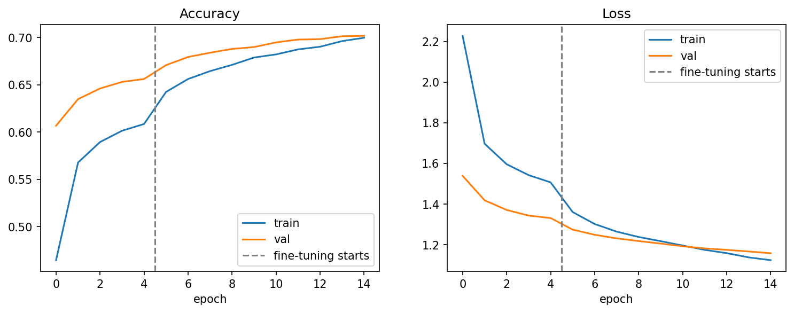
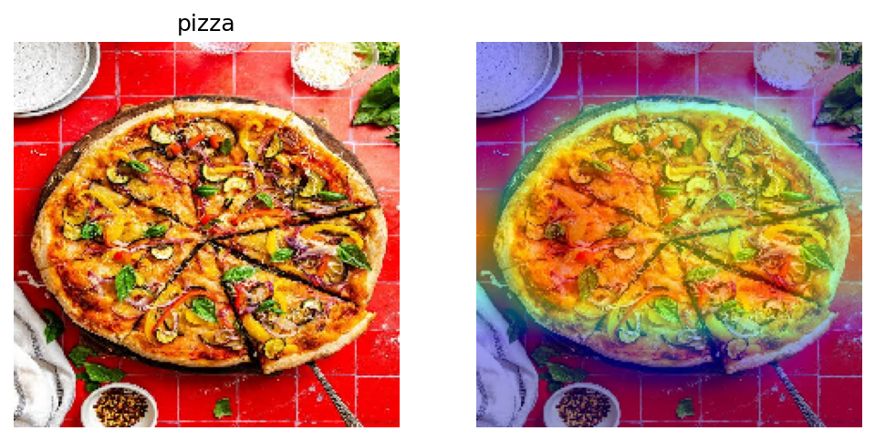

# 🍽️ Food Image Classifier & Calorie Estimator

Classify a photo of food into one of **101 dishes** and get an approximate calorie estimate for a typical serving. Built with **TensorFlow / Keras** using transfer learning (EfficientNetB0) on the **Food-101** dataset, with **Grad-CAM** visualisations to show what the model looks at.

[](https://colab.research.google.com/github/YOUR_USERNAME/food-calorie-estimator/blob/main/notebooks/01_training.ipynb)


<!-- TODO: add after deploying the app, then delete this comment
**[▶ Live demo on Hugging Face Spaces](https://huggingface.co/spaces/YOUR_USERNAME/food-calorie-estimator)**


-->

## Highlights

- **74.6% top-1 / 92.8% top-5 accuracy** on the official Food-101 test set (25,250 images, 101 classes).
- **Two-phase transfer learning:** train a new classification head first, then fine-tune the top of the backbone at a low learning rate.
- **Explainability:** Grad-CAM heatmaps highlight the image regions behind each prediction.
- **Calorie lookup** for all 101 classes, with a confidence threshold so the app says "not sure" instead of guessing.
- Trained end-to-end on a free Colab T4 GPU in roughly 55 minutes.

## Results

| Stage | Val top-1 | Val top-5 |
|---|---|---|
| Phase 1: frozen backbone, new head (5 epochs) | 65.6% | 87.6% |
| Phase 2: fine-tuning top 30 layers (best logged epoch) | 70.2% | 89.8% |

| Final model, official test set | Score |
|---|---|
| Top-1 accuracy | **74.6%** |
| Top-5 accuracy | **92.8%** |
| Macro F1 | 0.75 |

**Training curves** (dashed line = start of fine-tuning):



> **Why is test accuracy higher than validation accuracy?** Food-101's training images are intentionally left noisy (some mislabeled images), and my validation split is carved out of that training set. The official test set was manually cleaned, so it is an easier measure.

**Best and worst classes (F1):** edamame (0.97), macarons (0.94) and oysters (0.92) are recognised best. Apple pie (0.49), foie gras (0.50) and pork chop (0.50) are hardest. Full per-class numbers are in [`results/classification_report.txt`](results/classification_report.txt).

**Most confused pairs** (test images, out of 250 per class):

| True class | Predicted as | Count |
|---|---|---|
| steak | filet mignon | 40 |
| beef tartare | tuna tartare | 31 |
| steak | prime rib | 29 |
| apple pie | bread pudding | 29 |
| falafel | crab cakes | 28 |

The errors are mostly visually near-identical dishes (different cuts of beef, similar desserts), which is a reasonable failure mode rather than random noise.

## Explainability with Grad-CAM

Grad-CAM overlays a heatmap showing which regions pushed the model toward its prediction, which helps check that it looks at the food rather than the plate or background.



## Method

**Data.** Food-101 (101,000 images, 101 classes) loaded through `tensorflow_datasets`.

| Split | Images | Source |
|---|---|---|
| Train | 60,600 | first 80% of the official training set |
| Validation | 15,150 | last 20% of the official training set |
| Test | 25,250 | official test set |

**Model.** EfficientNetB0 (ImageNet weights) → global average pooling → dropout (0.3) → dense softmax (101). Total 4.18M parameters. Input is 224×224 with raw 0-255 pixels, because Keras' EfficientNet includes its own rescaling.

**Augmentation.** Random horizontal flip, rotation (±10%) and zoom (±10%), applied only during training.

**Training.** Batch size 32, Adam optimizer, checkpointing on best validation loss, early stopping and learning-rate reduction on plateau.

1. *Phase 1:* backbone frozen, only the 129k-parameter head trained (lr 1e-3, 5 epochs).
2. *Phase 2:* top 30 backbone layers unfrozen, BatchNorm layers kept frozen, lr 1e-5, 10 epochs.

## Calorie estimator

Food-101 has no nutrition labels, so `data/calories.csv` maps each class to a **typical serving size and approximate kcal**. For a photo, the app predicts the dish, looks up its calories, and optionally scales them by a portion multiplier. If the top prediction has less than 40% confidence, it returns "not sure" instead.

**Limitations**
- Calorie values are rough per-serving estimates, not verified nutrition data. Real portions and recipes vary a lot, so this is a demo and **not a dietary or medical tool**.
- The model cannot judge portion size from the image; the portion multiplier is user-supplied.
- Only 101 dishes are covered, and Food-101 is heavily Western/international. Many regional dishes (for example most Indian dishes) are missing.
- Photos with several dishes, or unusual angles and lighting, reduce accuracy.

## Repository structure

```
food-calorie-estimator/
├── notebooks/
│   └── train.ipynb      # data, training, evaluation, Grad-CAM, calorie lookup
├── app/
│   └── app.py                 # Gradio demo
├── data/
│   └── calories.csv           # class → serving size & kcal
├── models/
│   └── class_names.json       # label order used by the model
├── results/                   # training curves, Grad-CAM, classification report
├── requirements.txt           # inference / demo dependencies
└── README.md
```

The trained model file (`food_classifier.keras`) is not stored in git; download it from the [Releases](https://github.com/YOUR_USERNAME/food-calorie-estimator/releases) page and place it in `models/`.

## Getting started

**Option 1: Colab (recommended).** Click the badge at the top, select a GPU runtime (`Runtime → Change runtime type → T4 GPU`) and run all cells. Food-101 downloads automatically.

**Option 2: local.**

```bash
git clone https://github.com/YOUR_USERNAME/food-calorie-estimator.git
cd food-calorie-estimator
python -m venv .venv && source .venv/bin/activate   # Windows: .venv\Scripts\activate
pip install -r requirements-train.txt
jupyter notebook notebooks/01_training.ipynb
```

**Run the demo app** (after placing the model in `models/`):

```bash
pip install -r requirements.txt
python app/app.py
```

## Future work

- Add Indian and other regional dishes by fine-tuning on an extra dataset.
- Try larger backbones (EfficientNetB3) and higher input resolution.
- Estimate portion size from the image instead of a manual multiplier.
- Handle label noise in the training split.
- Export to TFLite for on-device inference.

## References

- L. Bossard, M. Guillaumin, L. Van Gool. *Food-101: Mining Discriminative Components with Random Forests.* ECCV 2014.
- M. Tan, Q. Le. *EfficientNet: Rethinking Model Scaling for Convolutional Neural Networks.* ICML 2019.
- R. Selvaraju et al. *Grad-CAM: Visual Explanations from Deep Networks via Gradient-based Localization.* ICCV 2017.

## License

MIT, see `LICENSE`.